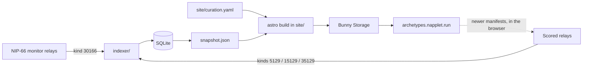

<div align="center">

# napplet archetypes

The source for [archetypes.napplet.run](https://archetypes.napplet.run), a field guide to the archetypes and intents that napplets advertise on Nostr relays.

[](https://github.com/napplet/archetypes/actions/workflows/ci.yml)
[](LICENSE)

</div>

## What is this?

Napplet manifests ([NIP-5D](https://github.com/nostr-protocol/nips/pull/2303), kinds 5129, 15129 and 35129) name what a napplet is with `z` tags (archetypes) and what it accepts with `i` tags (intents). The names are ad hoc. There is no registry, so two napplets that do the same thing can pick different names. This site reports which names people publish, how many napplets use each one, and which names look like synonyms. Contributors record decisions about those synonyms in a curation file by pull request.

The site is non-normative. The living [NIP-5D](https://github.com/nostr-protocol/nips/pull/2303) and [NAP-INTENT](https://github.com/napplet/naps) texts define the tags and how intents dispatch.

The repository holds two packages:

| Package | Directory | What it does |
| --- | --- | --- |
| `@napplet/archetypes` | [`site/`](site) | Astro site: archetype, intent and synonym-cluster pages, Markdown twins, `llms.txt`, JSON exports, JSON-LD and WebMCP tools. It builds from a snapshot of signed manifests. |
| `@napplet/archetypes-indexer` | [`indexer/`](indexer) | Node service: finds relays through NIP-66, crawls them for manifests into SQLite, builds the site once a day, and uploads it to Bunny Storage. |

## How the data flows



The indexer only reads events. It verifies every signature, and it never publishes to relays. Each page of the built site also asks the best-scored relays for manifests newer than the build and merges them in, so it stays current between daily builds. Without JavaScript, the static pages are still complete.

## Quick start

You need Node 24 or newer and pnpm 10 (`packageManager` pins 10.8.0).

```bash
pnpm install
pnpm dev            # site at http://localhost:4321, built from the checked-in seed snapshot
```

The site needs no network. Without an indexer snapshot (`ARCHETYPES_SNAPSHOT`), it builds from `site/src/data/snapshot.json`. `pnpm seed` refreshes that seed from the relay data the napplet.run app store saves in [napplet/web](https://github.com/napplet/web/tree/main/apps/web/src/data).

Run the indexer locally:

```bash
pnpm --filter @napplet/archetypes-indexer once      # one discovery-and-crawl tick, then exit
node indexer/src/main.ts --build                    # export the store and build the site now
```

The build deploys only when `BUNNY_STORAGE_ZONE` and `BUNNY_STORAGE_PASSWORD` are set. Otherwise it logs `deploy-skipped`.

## Checks

These are the commands CI runs:

```bash
pnpm type-check     # astro check and tsc for both packages
pnpm test:unit      # vitest for both packages
pnpm build          # build the site from the seed snapshot
pnpm check:site     # titles, descriptions, canonicals, landmarks, JSON-LD, links and Markdown twins on every page
```

CI also builds the container image and runs a site build inside it.

## Deploy

Production is one container and one data volume. The image carries both packages, because the indexer builds the site itself.

```bash
docker build -t archetypes-indexer .
docker run -v archetypes-data:/data \
  -e BUNNY_STORAGE_ZONE=… -e BUNNY_STORAGE_PASSWORD=… \
  archetypes-indexer
```

[`compose.yaml`](compose.yaml) runs the same container with a named volume. It listens on port 8080. `/healthz` returns 200 while ticks keep finishing, and `/status` reports counts, timings and the top-scored relays. All settings are optional. [`indexer/archetypes.example.yaml`](indexer/archetypes.example.yaml) lists each key with its default, and the [indexer README](indexer/README.md) covers the environment variables, the outbound proxy and the relay scoring.

A change merged to `main` reaches production when the container is redeployed from `main`. The daily build then picks up site and curation changes, or you can run `node src/main.ts --build` inside the container to rebuild right away.

## Curate synonyms

`site/curation.yaml` holds the editorial decisions: an archetype's status, and whether a cluster of names should coalesce, stay distinct, or stay diverse. Each cluster page on the site has an "Edit curation.yaml on GitHub" button and a draft entry to start from. The build rejects unknown keys and malformed entries. Curation is site data only. It never changes what a manifest means and is never published to relays. The [site README](site/README.md) documents the format and the similarity settings.

## Documentation

| Resource | Covers |
| --- | --- |
| [site/README.md](site/README.md) | Pages, agent surfaces, synonym heuristics, curation format |
| [indexer/README.md](indexer/README.md) | Discovery, crawl scoring and backoff, build and deploy, configuration, proxy |
| [AGENTS.md](AGENTS.md) | Rules for coding agents working in this repository |
| [archetypes.napplet.run/agents/](https://archetypes.napplet.run/agents/) | Machine-readable endpoints on the live site |

## Contributing

Open a pull request against `main`. Run the four checks above first. Curation changes need only the YAML edit and a passing build. For protocol questions, go to the canonical texts, not this site: a gap in NIP-5D or a NAP belongs on the [NAPs track](https://github.com/napplet/naps). Do not work around it here.

## License

[MIT](LICENSE)
